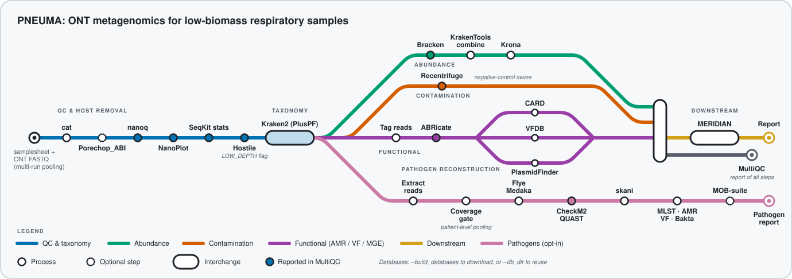

<p align="center">
  <picture>
    <source media="(prefers-color-scheme: dark)" srcset="docs/images/pneuma_logo_dark.svg">
    <source media="(prefers-color-scheme: light)" srcset="docs/images/pneuma_logo_light.svg">
    
  </picture>
</p>

<p align="center">
  <b>An end-to-end Nextflow DSL2 pipeline for Oxford Nanopore (ONT) long-read respiratory metagenomics</b><br/>
  Raw reads to host-free taxonomy, contamination assessment, resistome / virulome / plasmid profiling<br/>
  and a MERIDIAN downstream report, with multi-batch and multi-run pooling built in.
</p>

<p align="center">
  
  
  
  
  
  
</p>

---

## ✨ Why PNEUMA

Respiratory metagenomic cohorts are low-biomass, host-dominated and frequently sequenced across
several flow cells and batches. Turning ONT reads into a defensible taxonomic and resistome
picture normally means stitching together a dozen tools by hand, tracking databases and versions
in a notebook, and re-deriving contamination and pooling decisions for every study.

**PNEUMA** is an end-to-end Nextflow DSL2 pipeline for ONT long-read respiratory metagenomics,
built on the nf-core template. It targets cohort research: one samplesheet describes every
sample × run, reads from the same sample are pooled across runs and batches, negative controls
drive contamination assessment, and the results are handed straight to
[MERIDIAN](https://github.com/Julio92-C/meridian) for statistics and a publication-ready report.
Databases and tool versions are recorded in `pipeline_info/` for provenance.

---

## 🗺️ Pipeline overview

<p align="center">
  
</p>

The diagram is generated by [`docs/images/make_metro_map.py`](docs/images/make_metro_map.py)
(standard library only). Grey dashed lines and stations are planned, not yet implemented.

---

## 🚀 Features

**Phase 1 (implemented)**

- **Preprocess**: `cat` (pool runs per sample), `porechop_abi` (optional adapter trimming), `nanoq` (length/quality filter), `NanoPlot` and `seqkit stats` (QC), `Hostile` host removal, and a `LOW_DEPTH` flag for samples with fewer than `--min_reads` reads after host removal.
- **Taxonomy**: `Kraken2` (PlusPF index), `Bracken`, `KrakenTools` report combination and `Krona`.
- **Contamination**: `Recentrifuge` in plain mode and, when the samplesheet marks negative controls, in control mode.
- **Functional reads**: `ABRicate` with `card`, `vfdb` and `plasmidfinder` (80 % identity / 80 % coverage) on Kraken-tagged reads.
- **MERIDIAN hand-off**: config generation plus a run in the container `ghcr.io/julio92-c/meridian:v1.0.0`.
- Profiles: `docker`, `singularity`, `test`, and `myriad` (UCL HPC). Reproducible database staging with `bin/prepare_databases.sh`.

**Phase 2 (planned)**

- Priority-pathogen reconstruction: assembly, CheckM2, Bakta, MLST, and AMR/VF/MGE calls collected in a pathogen report.
- A WHO-priority respiratory panel in tiers 1, 2, 3 and D, plus a reservoir commensals list.

**Phase 3 (planned)**

- Validation: regression tests, spike-ins and a full cohort run.

---

## 📦 Installation

Requirements:

- [Nextflow](https://www.nextflow.io/) `>= 25.10.4`
- [Docker](https://www.docker.com/) or [Singularity / Apptainer](https://sylabs.io/docs/)
- Reference databases: Kraken2 PlusPF index, NCBI taxdump, Hostile index and ABRicate databases

Run directly from GitHub (no clone needed). Pin a release tag with `-r` so the exact pipeline
code is recorded and the run is reproducible:

```bash
nextflow pull Julio92-C/pneuma -r v0.1.0
```

Stage the databases once with [`bin/prepare_databases.sh`](bin/prepare_databases.sh). After
`nextflow pull` the script is at `~/.nextflow/assets/Julio92-C/pneuma/bin/prepare_databases.sh`:

```bash
bash ~/.nextflow/assets/Julio92-C/pneuma/bin/prepare_databases.sh   --outdir ~/pneuma_db --kraken-release <YYYYMMDD> --taxdump-month <YYYY-MM>
```

It prints the `--kraken2_db`, `--taxdump`, `--host_index`, `--abricate_db` and
`--database_manifest` parameters to reuse. See [docs/usage.md](docs/usage.md) for details and
for the UCL Myriad notes.

**For development**, clone the repository instead:

```bash
git clone https://github.com/Julio92-C/pneuma.git
cd pneuma
```

---

## ⚡ Quickstart

Check the installation with the bundled test profile (small public test data, MERIDIAN skipped):

```bash
nextflow run Julio92-C/pneuma -r v0.1.0 -profile test,docker --outdir results_test
```

Run on your own data, choosing the profile `docker`, `singularity` or `myriad` (UCL HPC):

```bash
nextflow run Julio92-C/pneuma -r v0.1.0 -profile <docker|singularity|myriad>   --input samplesheet.csv --outdir results   --kraken2_db <db> --taxdump <taxdump> --host_index <hostile_index>   --abricate_db <abricate_dir> --database_manifest <database_manifest.tsv>   --meridian_metadata metadata.csv --meridian_group <group_column> --meridian_random_effect <patient_column>   -resume
```

Always pin `-r <tag>` (for example `-r v0.1.0`) for reproducibility; without it Nextflow runs the
default branch. `--input` and `--outdir` are always required, `--kraken2_db`, `--taxdump` and
`--host_index` are required, and `--meridian_metadata` / `--meridian_group` are required unless you
pass `--skip_meridian`. Pass pipeline parameters on the command line or with `-params-file`, not
in a custom `-c` config. See [docs/usage.md](docs/usage.md) for the Myriad notes.

From a development clone, replace `Julio92-C/pneuma -r v0.1.0` with `.`.

**Database parameters.** `--abricate_db` is the *directory* that holds the ABRicate databases
(the `<outdir>/abricate` folder written by `prepare_databases.sh`, containing `card/`, `vfdb/`
and `plasmidfinder/`). It is not a database name. The separate `--abricate_dbs` parameter is the
comma-separated list of database *names* to search (default `card,vfdb,plasmidfinder`).

---

## 📥 Inputs (samplesheet)

A CSV with one row per **sample × run** (schema: [`assets/schema_input.json`](assets/schema_input.json)).
A sample sequenced on several flow cells gets several rows with the same `sample`; their reads are
concatenated.

| Column | Required | Description |
| --- | --- | --- |
| `sample` | yes | Sample name; must match `^[A-Za-z0-9][A-Za-z0-9-]*$` (no `_` or `.`) |
| `run_id` | yes | Sequencing run / flow cell identifier (no spaces); `sample` + `run_id` must be unique |
| `batch` | yes | Batch identifier (no spaces) |
| `site` | no | Sampling site or cohort label |
| `fastq` | yes | Path to an existing `.fastq.gz` / `.fq.gz` file |
| `is_control` | yes | `true` for negative controls (used by Recentrifuge control mode), otherwise `false` |

```csv
sample,run_id,batch,site,fastq,is_control
SAMPLE-01,RUN1,BATCH1,SITEA,/path/to/SAMPLE-01_run1.fastq.gz,false
SAMPLE-01,RUN2,BATCH1,SITEA,/path/to/SAMPLE-01_run2.fastq.gz,false
CONTROL-01,RUN1,BATCH1,SITEA,/path/to/CONTROL-01_run1.fastq.gz,true
```

Optional study metadata for MERIDIAN is a separate CSV passed with `--meridian_metadata`.

---

## 📤 Outputs

Results are written under `--outdir`:

| Directory | Contents |
| --- | --- |
| `preprocess/` | nanoq stats, host-free reads (`clean_reads/`), NanoPlot, seqkit stats |
| `taxonomy/` | Kraken2 reports and per-read assignments, Bracken, combined reports, `bracken_arranged.csv`, Krona |
| `contamination/` | `pneuma.rcf.data.csv`, `pneuma.rcf.html`, `pneuma_controls.rcf.*` (when controls are present) |
| `functional/` | per-sample ABRicate tables and `summary_reportClean.csv` |
| `meridian/` | MERIDIAN `config.yaml`, `Datasets/`, `Figures/`, `Reports/` |
| `multiqc/` | MultiQC report |
| `pipeline_info/` | Nextflow reports, software versions, `database_manifest.tsv` |

A file-by-file description is in [docs/output.md](docs/output.md).

---

## 🔗 MERIDIAN hand-off

PNEUMA ends where [MERIDIAN](https://github.com/Julio92-C/meridian) begins. The `MERIDIAN`
subworkflow rearranges the combined Kraken2/Bracken reports, the Recentrifuge table and the
ABRicate summary into MERIDIAN's input layout, renders a `config.yaml` from
[`assets/meridian_config.template.yaml`](assets/meridian_config.template.yaml) (checking the
metadata against the samples), and runs MERIDIAN in the container
`ghcr.io/julio92-c/meridian:v1.0.0`.

| Parameter | Purpose |
| --- | --- |
| `--meridian_metadata` | study metadata CSV (one row per sample) |
| `--meridian_group` | metadata column holding the comparison groups |
| `--meridian_random_effect` | metadata column holding the repeated-measure / patient identifier |
| `--meridian_study_id` | study label (default `pneuma`) |
| `--skip_meridian` | stop after the PNEUMA stages |

---

## 🧭 Roadmap

- [x] **Phase 1, core**: preprocess, taxonomy, contamination, functional reads, MERIDIAN hand-off, Myriad profile and database staging.
- [ ] **Phase 2, pathogens**: priority-pathogen reconstruction (assembly, CheckM2, Bakta, MLST, AMR/VF/MGE pathogen report) and the WHO-priority respiratory panel (tiers 1, 2, 3, D) with a reservoir commensals list.
- [ ] **Phase 3, validation**: regression tests, spike-ins and a full cohort.

---

## 🗂️ Repository layout

```text
main.nf, nextflow.config, nextflow_schema.json   entry point, defaults and parameter schema
workflows/pneuma.nf                              top-level workflow
subworkflows/local/                              preprocess, taxonomy, contamination, functional_reads, meridian
modules/local/ , modules/nf-core/                pipeline-specific and nf-core modules
conf/                                            profiles (test, myriad, containers) and publishDir rules
bin/                                             helper scripts (prepare_databases.sh, read tagging, ABRicate merge, ...)
assets/                                          samplesheet schema and examples, MERIDIAN config template
docs/                                            usage, output, images (metro map, logos)
tests/                                           nf-test files, pytest suite (tests/python), fixtures (tests/data)
```

---

## 🤝 Contributing

Development happens on feature branches; the pipeline follows nf-core conventions. See the
[contributing guidelines](docs/CONTRIBUTING.md). Run the unit tests with:

```bash
pip install pytest && pytest tests/python -q
nf-test test --profile docker
```

The tiny ABRicate fixture database in `tests/data/abricate_db/` was built with
`abricate --setupdb` inside `quay.io/biocontainers/abricate:1.0.1--ha8f3691_1`. It must be
regenerated if the ABRicate image is bumped (the BLAST index version can change). Fixture
provenance is listed in [tests/data/README.md](tests/data/README.md).

---

## 📚 Citation

Manuscript in preparation.

Please also cite the tools used by the pipeline; they are listed with DOIs in
[`CITATIONS.md`](CITATIONS.md). PNEUMA uses code and infrastructure from the
[nf-core](https://nf-co.re) community, reused under the
[MIT license](https://github.com/nf-core/tools/blob/main/LICENSE).

> **The nf-core framework for community-curated bioinformatics pipelines.**
>
> Philip Ewels, Alexander Peltzer, Sven Fillinger, Harshil Patel, Johannes Alneberg, Andreas Wilm, Maxime Ulysse Garcia, Paolo Di Tommaso & Sven Nahnsen.
>
> _Nat Biotechnol._ 2020 Feb 13. doi: [10.1038/s41587-020-0439-x](https://dx.doi.org/10.1038/s41587-020-0439-x).

---

## 📬 Contact

👤 **Julio C. Ortega Cambara**

🎓 PhD Candidate — Computational Bioinformatics

🏛️ School of Biomedical Sciences, University of West London

📍 St Mary's Rd, London W5 5RF

✉️ Email: [32104617@student.uwl.ac.uk](mailto:32104617@student.uwl.ac.uk)

---

## 📜 License

Released under the [MIT License](LICENSE).
